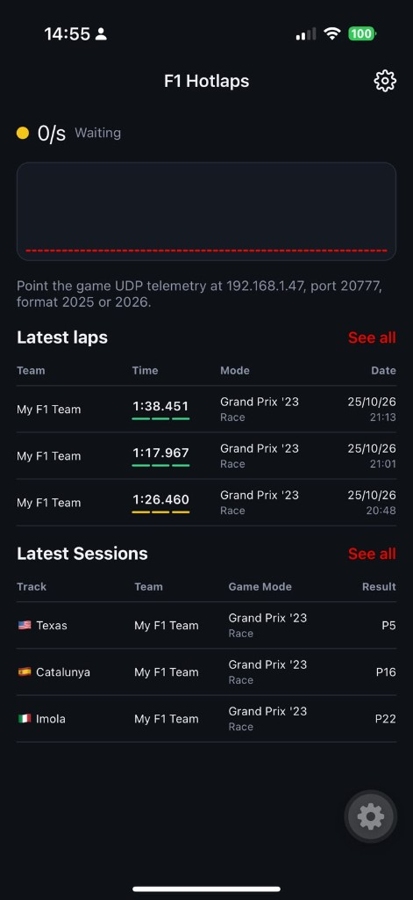
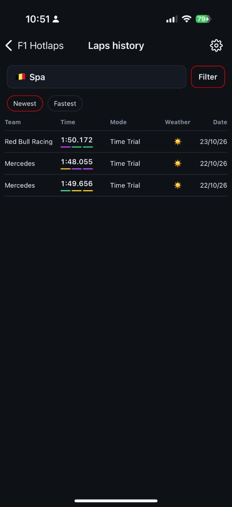
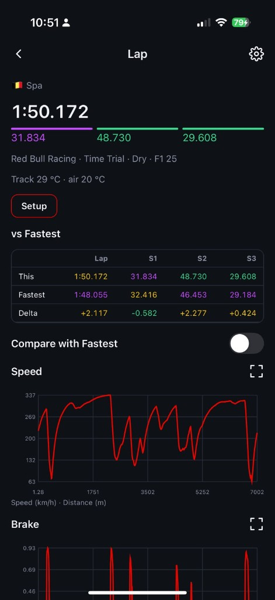

# F1 Hotlaps

F1 Hotlaps records the laps you drive in EA SPORTS F1 25 and F1 26. The game sends UDP telemetry on your local network. The phone receives it, keeps the laps that count, and stores them on the device. There is no account and no server. Export is the only way the data leaves the phone, and Import is how a previous export comes back.

This project is not affiliated with, endorsed by, or connected to Electronic Arts or Codemasters. F1 and EA SPORTS are trademarks of their owners.

<table>
  <tr>
    <td align="center" width="33%"><br>Home, waiting for telemetry</td>
    <td align="center" width="33%"><br>Laps on Spa, newest first</td>
    <td align="center" width="33%"><br>A lap at Spa, compared with the fastest</td>
  </tr>
</table>

## What you get

While the game is sending telemetry, the home screen shows whether the phone is receiving, the packet rate, and the car you are driving: track, session, lap time, speed, throttle, and brake.

A lap is stored when the app saw it start and the game reports a lap time. Laps the game marks invalid are stored when Store invalid laps is on, which it is by default, and history hides them until that filter is turned off. Laps with a pit stop, flashbacks, and laps still in progress are not stored. Each stored lap keeps its time, sectors, tyre, car setup, track and air temperature, and a trace: speed, throttle, brake, gear, DRS, and ERS along the lap, one sample about every 10 metres.

Open a lap to see its sectors against the others on that track, the car setup, and graphs for the trace. You can overlay the fastest lap on the same track and condition (dry or wet) and see the time delta along the distance.

## Requirements

- Node.js 24 (see `.nvmrc`) and [pnpm](https://pnpm.io) via Corepack
- Xcode for iOS, or Android Studio for Android
- A development build. Expo Go cannot run this app: UDP and picture-in-picture are native modules
- The phone and the machine running the game on the same network

## Run

```sh
corepack enable
corepack pnpm install
pnpm ios      # or: pnpm android
pnpm dev      # Metro, for the dev client
```

`pnpm ios` and `pnpm android` compile the native app and install it. After that, `pnpm dev` is enough for JavaScript changes. `ios/` and `android/` are generated by Expo and are not part of the repo.

Release builds for a device you already trust:

```sh
pnpm preview:ios
pnpm preview:android
```

## Point the game at the phone

In the game, turn on UDP telemetry and set:

| Setting | Value |
| --- | --- |
| IP address | The LAN address shown in the app (home screen while waiting, or Config) |
| Port | `20777`, unless you changed it in Config |
| Format | `2025` for F1 25, `2026` for F1 26 |
| Send rate | Any rate the game offers. The home screen shows packets per second |

The phone must be on the same Wi-Fi or LAN as the game. On iOS, allow local network access when the system asks.

If the status stays on Waiting, the game is not reaching the phone. If it says the format is unsupported, the UDP format in the game is not 2025 or 2026.

## Picture-in-picture

iOS and Android stop a UDP socket when the app is fully in the background. Leaving the app for another one drops telemetry. Picture-in-picture keeps the listener alive and shows the status dot and packet rate. Your music keeps playing. After 30 minutes with no packets, picture-in-picture closes and the in-progress lap is dropped so the phone can sleep.

## Config

- **UDP port.** 1024–65535. The listener restarts on the new port.
- **Units.** km/h and °C, or mph and °F.
- **Traces.** On by default, every lap keeps a trace (about 2 MB for 100 laps on a typical track). Turn it off to keep traces only for the fastest lap and the latest other lap on each track and condition. Lap times stay either way.
- **Export.** Shares one JSON file, named `f1-hotlaps-export-….json`, through the system share sheet. The file is format 1 and holds every session, lap, and trace, including a race result when the game sent one. It is written compact, with no extra whitespace. Speeds stay in km/h and temperatures in °C, whichever units the app is showing. The UDP port, units, and trace setting are not in the file.
- **Import.** Opens the file picker. Choosing an export asks you to confirm, then replaces every stored session, lap, and trace with the contents of the file. It does not merge with what is already on the phone. A pretty-printed copy of the same file imports too. Canceling the picker leaves the stored data as it is. A file this app cannot read is refused, and Config shows why: it is not JSON, it is not format 1, or its sessions, laps, and traces do not fit together. Replacing the data cannot be undone.
- **Wipe data.** Deletes stored sessions, laps, and traces. You can keep the fastest lap on each track. This cannot be undone.

## Develop

```sh
pnpm typecheck
pnpm lint
pnpm test
```

`src/protocol/` decodes F1 25 and F1 26 packets. `docs/telemetry/` holds the UDP structure headers published by Electronic Arts; those files remain theirs. Tests use trimmed recordings in `fixtures/packets/`. How to capture, replay, and trim them is in [`fixtures/packets/README.md`](fixtures/packets/README.md).

```sh
pnpm packets capture --port 20777 --out fixtures/captures/session.bin
pnpm packets replay fixtures/captures/session.bin --to 127.0.0.1:20777
pnpm packets trim fixtures/captures/session.bin --from 61.2s --to 152.9s --out fixtures/packets/f1-26-clean-lap.bin.gz
```

Full captures belong in `fixtures/captures/`, which is gitignored.
